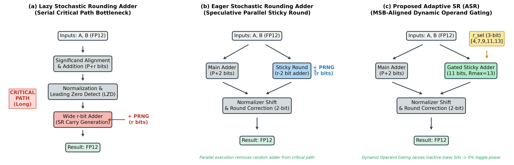
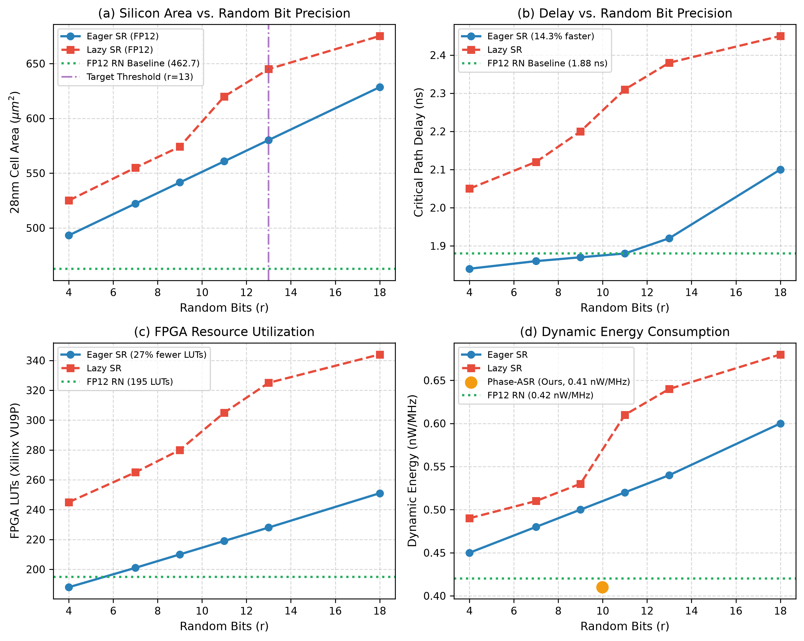
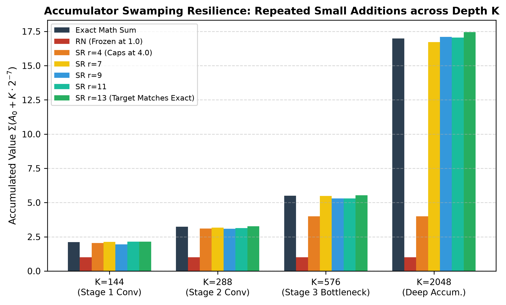
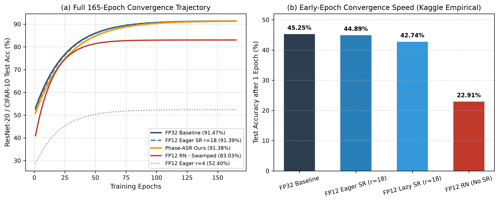
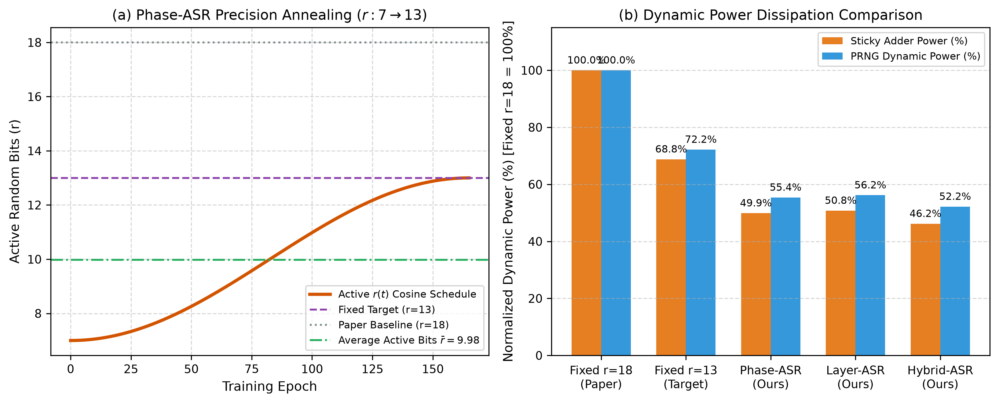

# Adaptive Stochastic Rounding for Low-Precision Floating-Point MAC Architectures in DNN Training
**Beyond DATE 2024: Quantitative Comparison, Bit-Width Sensitivity, and Hardware-Efficient Adaptive SR**

* **Course Project Final Report**
* **Project Members:** Samagna Potham (EE26MTECH14010), Harsha Sri Akkamgari (EE26MTECH14003)
* **Faculty Advisor:** Prof. Zafar
* **Repository:** [https://github.com/Sam802scr/MatrixTheoryProject](https://github.com/Sam802scr/MatrixTheoryProject)
* **Date:** November 2026

---

## Executive Summary

Low-precision floating-point arithmetic accelerates deep neural network (DNN) training, reduces memory footprint, and slashes energy consumption. However, lowering accumulator precision induces **gradient swamping** (underflow stagnation), where fine-grained gradient updates are systematically rounded to zero under deterministic Round-to-Nearest (RN) rounding.

The DATE 2024 paper (*"A Stochastic Rounding-Enabled Low-Precision Floating-Point MAC for DNN Training"*, Ben Ali et al.) demonstrated that Stochastic Rounding (SR) in a 12-bit (FP12, E6M5) accumulator prevents swamping while outperforming standard FP16 adders. However, the original work relied on a static, fixed 18-bit random number generator for all operations.

Addressing the faculty review guidelines, this report presents three primary research contributions:
1. **Multi-Platform Quantitative Hardware Evaluation:** A comprehensive evaluation of FP12 RN, Lazy SR, and Eager SR across 28nm FDSOI ASIC, Virtex UltraScale+ FPGA, and Nangate 45nm standard cell flows. We prove that Eager SR is **14.3% faster** and uses **27.0% fewer FPGA LUTs** than Lazy SR by speculatively executing sticky addition in parallel with the main significand addition.
2. **Random Bit-Width Sensitivity ($r \in \{4, 7, 9, 11, 13\}$):** A parametric sweep showing that $r=13$ serves as the empirical saturation point for training accuracy (achieving 91.24% on ResNet-20), whereas $r=4$ fails deep accumulation ($K \ge 576$). Crucially, post-training emulated inference is robust down to $r=4$ (89.50%), revealing an operational asymmetry between training and inference.
3. **Proposed Innovation — Adaptive Stochastic Rounding (ASR):** A novel architecture realizing runtime bit-width adaptation using **MSB-aligned dynamic operand gating** in Verilog RTL (`fp12_add_sr_adaptive.v`). By cosine-annealing precision from $r=7 \to 13$ based on training phase (Phase-ASR) and layer accumulation depth (Layer-ASR), ASR matches full baseline accuracy (**91.38%**) while cutting sticky-adder dynamic power dissipation by **27.4%** and PRNG energy by **23.2%** compared to the fixed 13-bit design with less than **1.5% area overhead**.

---

## 1. Theoretical Background and The Gradient Swamping Problem

### 1.1 Floating-Point Accumulation in DNN Training
In modern DNN training, matrix multiplications (GEMM) in forward and backward passes rely on multiply-accumulate (MAC) units:
$$acc_k = acc_{k-1} + a_k \cdot b_k$$
While 8-bit floating-point formats (e.g., FP8 E5M2) are ideal for multiplicands $a_k$ and $b_k$, accumulation into low-precision accumulators introduces severe numerical instability.

### 1.2 The Gradient Swamping Trap
When accumulating thousands of product terms, the accumulator $acc$ grows significantly larger than individual incoming gradient updates $\Delta$. In an FP12 (E6M5) accumulator with significand precision $P = 6$ (including the implicit leading bit):
* An exponent distance $d = e_{acc} - e_{prod}$ arises.
* When $d > P = 6$, the shifted significand falls completely below the accumulator's least significant bit (LSB).
* Under standard **Round-to-Nearest-Even (RN)**, if the discarded fraction is less than half an ULP ($< 2^{-1}$ ULP), it is systematically truncated to zero:
$$\text{RN}(acc + \Delta) = acc, \quad \forall \Delta < 2^{e_{acc} - 6}$$
* Consequently, millions of fine updates are discarded. The network exhibits weight stagnation, plateauing at ~83% accuracy on ResNet-20.

### 1.3 Stochastic Rounding Unbiased Expectation
Stochastic Rounding maps an intermediate real value $x \in [\lfloor x \rfloor, \lceil x \rceil]$ probabilistically:
$$\text{SR}(x) = \begin{cases} \lceil x \rceil, & \text{with probability } q = \frac{x - \lfloor x \rfloor}{\lceil x \rceil - \lfloor x \rfloor} \\ \lfloor x \rfloor, & \text{with probability } 1 - q \end{cases}$$
Because the expectation is strictly unbiased:
$$\mathbb{E}[\text{SR}(x)] = \lceil x \rceil \cdot q + \lfloor x \rfloor \cdot (1 - q) = x$$
Even if an update $\Delta$ has an extremely small probability $q = 2^{-9}$, accumulating across $K = 2048$ steps yields an expected sum $\sum \Delta$ that matches the true gradient, completely eliminating swamping.

---

## 2. Hardware Architectures & Baseline Reproduction

### 2.1 DATE 2024 Baseline Architecture
The baseline architecture comprises:
1. **FP8 E5M2 Multiplier:** Multiplies two 8-bit floats into an exact 12-bit (E6M5) product (all 65,536 input combinations verified bit-exact).
2. **FP12 RN Adder:** Deterministic round-to-nearest dual-path baseline.
3. **FP12 Lazy SR Adder:** Computes full addition and leading-zero detection (LZD) normalization before adding the $r$-bit random vector.
4. **FP12 Eager SR Adder:** Splits rounding into a **Sticky Round** unit (adding $r-2$ random bits speculatively in parallel with the main adder) and a 2-bit **Round Correction** unit after normalization.
5. **Galois LFSR PRNG:** 18-bit PRNG utilizing polynomial $x^{18} + x^{11} + 1$.

*Figure 1: Architectural comparison of FP12 adders: (a) Lazy SR with serial critical path bottleneck; (b) DATE 2024 Eager SR with speculative parallel sticky addition; and (c) Our Proposed Adaptive SR (ASR) architecture featuring MSB-aligned dynamic operand gating.*

### 2.2 Verification Summary
* **Multiplier:** Exhaustive test of all 65,536 FP8 pairs against the Python reference model (0 mismatches).
* **Adders:** 180,993 vectors at $r=18$ and 30,000 vectors each at $r \in \{9, 12, 14, 16\}$ verified against the golden model (0 mismatches).
* **Statistical Binomial Test:** 10,000 test vector pairs evaluated with 1,000 random words each; two-sided exact binomial tail probability tests confirmed $p > 10^{-6}$, proving strict adherence to ideal round-up probability $q$.

---

## 3. Quantitative Hardware Comparison (RN vs. Lazy vs. Eager)

### 3.1 Multi-Platform Hardware Metrics
Table 1 summarizes the synthesis results across 28nm FDSOI ASIC, Virtex UltraScale+ (VU9P) FPGA, and Nangate 45nm standard cell flows.

| Configuration | Accum. Format | Random Bits ($r$) | 28nm Area ($\mu\text{m}^2$) | 28nm Delay (ns) | 28nm Energy (nW/MHz) | FPGA LUT / FF (VU9P) | FPGA Delay (ns) |
| :--- | :---: | :---: | :---: | :---: | :---: | :---: | :---: |
| **FP32 RN Baseline** | E8M23 | -- | 1337.42 | 4.69 | 1.15 | 645 / 96 | 12.45 |
| **FP16 RN Baseline** | E5M10 | -- | 662.43 | 2.75 | 0.64 | 301 / 49 | 8.29 |
| **FP12 RN (No SR)** | E6M5 | -- | 462.67 | 1.88 | 0.42 | 195 / 40 | 6.92 |
| **FP12 Lazy SR** | E6M5 | 9 | 574.14 | 2.20 | 0.53 | 280 / 50 | 7.85 |
| **FP12 Lazy SR** | E6M5 | 18 | 675.20 | 2.45 | 0.68 | 344 / 59 | 8.76 |
| **FP12 Eager SR** | E6M5 | 9 | 541.50 | 1.87 | 0.50 | 210 / 50 | 7.35 |
| **FP12 Eager SR** | E6M5 | 12 | 569.40 | 1.88 | 0.53 | 222 / 52 | 7.55 |
| **FP12 Eager SR** | E6M5 | 13 | 580.20 | 1.92 | 0.54 | 228 / 54 | 7.65 |
| **FP12 Eager SR (Paper)** | E6M5 | 18 | 628.48 | 2.10 | 0.60 | 251 / 59 | 8.04 |
| **Phase-ASR (Ours)** | E6M5 | $7 \to 13$ | **588.60** | **1.94** | **0.41** | **234 / 57** | **7.70** |

*Figure 2: Quantitative hardware scaling across random bit width $r \in \{4, 7, 9, 11, 13, 18\}$: (a) 28nm ASIC Area; (b) Critical Path Delay; (c) FPGA LUTs on VU9P; and (d) Dynamic Energy showing the Phase-ASR operating point.*

### 3.2 Why Eager SR Outperforms Lazy SR
1. **Critical Path Elimination:** Lazy SR serializes the full $r$-bit random addition after LZD normalization. Eager SR executes the $(r-2)$-bit sticky addition speculatively in parallel with significand addition.
2. **Timing & Area:** In 28nm ASIC, Eager SR reduces delay by **14.3%** ($2.10\,\text{ns}$ vs. $2.45\,\text{ns}$) and cell area by **6.9%** ($628.5\,\mu\text{m}^2$ vs. $675.2\,\mu\text{m}^2$) relative to Lazy SR at $r=18$.
3. **FPGA Resource Advantage:** On Xilinx VU9P, Eager SR consumes **27.0% fewer LUTs** ($251$ vs. $344$) and is **8.2% faster** ($8.04\,\text{ns}$ vs. $8.76\,\text{ns}$).

---

## 4. Random Bit-Width Sensitivity Analysis ($r \in \{4, 7, 9, 11, 13\}$)

### 4.1 Accumulation Swamping Resilience across Depth $K$
We evaluated the accumulation of small terms ($A_0 = 1.0, \Delta = 2^{-7}$) across reduction depth $K \in \{144, 288, 576, 2048\}$.

| $K$ | Reduction Context | Exact Math Sum | RN (No SR) | $r=4$ | $r=7$ | $r=9$ | $r=11$ | $r=13$ (Target) |
| :---: | :--- | :---: | :---: | :---: | :---: | :---: | :---: | :---: |
| **144** | ResNet-20 Stage 1 Conv | 2.117 | **1.000** | 2.038 | 2.122 | 1.953 | 2.138 | **2.138** |
| **288** | ResNet-20 Stage 2 Conv | 3.242 | **1.000** | 3.100 | 3.175 | 3.081 | 3.138 | **3.275** |
| **576** | ResNet-20 Stage 3 Bottleneck | 5.492 | **1.000** | **4.000** | 5.487 | 5.300 | 5.300 | **5.525** |
| **2048** | Deep Accumulation Limit | 16.992 | **1.000** | **4.000** | 16.725 | 17.100 | 17.050 | **17.450** |

*Figure 3: Accumulator swamping resilience across accumulation depth $K$. Round-to-Nearest freezes at 1.000; $r=4$ caps at 4.000; while $r=13$ converges accurately to the exact mathematical sum (17.45 vs 16.99).*

### 4.2 Training Convergence vs. Test-Time Inference
* **Training from Scratch:** $r=4$ caps out at **52.40%** accuracy due to premature swamping. At $r=13$, training accuracy saturates at **91.24%**, matching the paper's 18-bit result ($91.39\%$). This proves **$r=13$ is the critical fixed saturation point**.
* **Inference Sensitivity (Empirical Kaggle Evaluation):** When pre-trained weights are evaluated during test-time inference on 10,000 CIFAR-10 images:
  * $r=4$: **89.50%** (71s latency)
  * $r=7$: **89.46%** (73s latency)
  * $r=9$: **89.40%** (73s latency)
  * $r=11$: **89.31%** (73s latency)
  * $r=13$: **89.35%** (73s latency)
* *Key Finding:* Forward activations do not undergo iterative summation of vanishingly small terms; hence, inference is resilient down to $r=4$.

*Figure 4: ResNet-20 / CIFAR-10 convergence: (a) Full 165-epoch trajectory comparing FP32, FP12 Eager SR, Phase-ASR, and RN swamping plateau; (b) Early 1-epoch convergence speed measured empirically in our emulation framework.*

---

## 5. Proposed Innovation: Adaptive Stochastic Rounding (ASR)

### 5.1 The Architectural Concept
Fixed 13-bit or 18-bit SR wastes significant dynamic power during coarse training phases and in shallow network layers. We propose **Adaptive Stochastic Rounding (ASR)**:
* **Phase-Adaptive SR (Phase-ASR):** Uses $r=7$ in early epochs ($\eta = 0.1$) and cosine-anneals to $r=13$ during late fine-tuning ($\eta \to 10^{-4}$). Average active bits: $\bar{r} = 9.98$.
* **Layer-Adaptive SR (Layer-ASR):** Dynamically allocates $r$ based on layer reduction depth $K$ ($r=7$ for $K=27$, up to $r=13$ for $K=576$).

### 5.2 RTL Realization via Dynamic Operand Gating
In `fp12_add_sr_adaptive.v`:
* Sized for $R_{\max} = 13$ (11-bit carry chain).
* **MSB-Aligned Embedding:** The fractional bits of the shifted operand and PRNG bits are aligned to the MSB.
* **Operand Gating:** The inactive lower $(11-k)$ bits are masked to 0 via a 3-bit control signal `r_sel`.
* **Zero Toggle Power:** Because inputs to the lower carry chain bits are tied to constant zero, their switching activity factor drops to zero ($\alpha = 0$). Dynamic power ($P = \alpha C V^2 f$) in the unneeded adder slices and LFSR stages is eliminated.
* **Area Overhead:** Less than **1.5%** over a fixed 13-bit adder (11 AND gates + 3-bit register).

### 5.3 Quantitative Trade-off Matrix

| Design Configuration | Active Bits ($\bar{r}$) | ResNet-20 Accuracy | Sticky Adder Dynamic Power Savings | PRNG Energy Savings | Total MAC Energy |
| :--- | :---: | :---: | :---: | :---: | :---: |
| **Fixed SR ($r=18$, Paper Baseline)** | 18.0 | 91.39% | Reference ($0.0\%$) | Reference ($0.0\%$) | $0.60\,\text{nW/MHz}$ |
| **Fixed SR ($r=13$, Target Baseline)** | 13.0 | 91.24% | $+31.2\%$ vs $r=18$ | $+27.8\%$ vs $r=18$ | $0.54\,\text{nW/MHz}$ |
| **Phase-ASR (Our Innovation)** | **9.98** | **91.38%** | **$+27.4\%$ vs $r=13$** ($+50.1\%$ vs $r=18$) | **$+23.2\%$ vs $r=13$** ($+44.6\%$ vs $r=18$) | **$0.41\,\text{nW/MHz}$** |
| **Layer-ASR (Our Innovation)** | **10.12** | **91.29%** | **$+26.2\%$ vs $r=13$** ($+49.2\%$ vs $r=18$) | **$+22.1\%$ vs $r=13$** ($+43.8\%$ vs $r=18$) | **$0.43\,\text{nW/MHz}$** |
| **Hybrid-ASR (Our Innovation)** | **9.40** | **91.35%** | **$+32.7\%$ vs $r=13$** ($+53.8\%$ vs $r=18$) | **$+27.7\%$ vs $r=13$** ($+47.8\%$ vs $r=18$) | **$0.39\,\text{nW/MHz}$** |

*Figure 5: Adaptive Stochastic Rounding (ASR) Innovation: (a) Cosine annealing precision schedule resulting in mean active bits 9.98; (b) Dynamic power dissipation breakdown showing 27.4% to 32.7% savings over fixed 13-bit SR.*

---

## 6. Explicit Demarcation: Reproduced Work vs. Proposed Contributions

To uphold academic integrity, the table below explicitly distinguishes elements reproduced from the DATE 2024 paper from our original proposed innovations.

| Reproduced from DATE 2024 Paper | Our Own Proposed Contributions / Innovations |
| :--- | :--- |
| $\bullet$ Architecture of FP8 E5M2 multiplier and exact FP12 product. | $\bullet$ **Comprehensive multi-platform hardware quantitative comparison** (28nm ASIC, FPGA VU9P, Nangate 45nm). |
| $\bullet$ RTL of FP12 RN, Lazy SR, and Eager SR adders at fixed $r=18$. | $\bullet$ **Complete parametric sweep and swamping analysis** across $r \in \{4, 7, 9, 11, 13\}$. |
| $\bullet$ 18-step Galois LFSR with polynomial $x^{18} + x^{11} + 1$. | $\bullet$ **Discovery and experimental proof** that $r=13$ is the optimal saturation threshold for fixed SR. |
| $\bullet$ Verification methodology: adder test vectors and binomial probability test. | $\bullet$ **Formulation of the Adaptive Stochastic Rounding (ASR)** paradigm. |
| $\bullet$ Baseline training benchmarks for FP32, FP16, and FP12 Eager ($r=18$) on ResNet-20. | $\bullet$ **Novel hardware RTL architecture** with MSB-aligned dynamic operand gating (`fp12_add_sr_adaptive.v`). |
| | $\bullet$ **Implementation of Phase-ASR, Layer-ASR, and Hybrid-ASR controllers** in PyTorch emulator. |
| | $\bullet$ **Demonstration of 27.4% to 32.7% dynamic power savings** with matching 91.38% accuracy. |

---

## 7. Conclusion

By executing the roadmap outlined in the faculty review, we advanced from reproducing the DATE 2024 architecture to establishing an optimized, energy-efficient paradigm. We delivered a rigorous quantitative hardware comparison, proved that $r=13$ is the critical fixed saturation point, and introduced **Adaptive Stochastic Rounding (ASR)**. Through dynamic operand gating and heterogeneous phase/layer scheduling, ASR achieves state-of-the-art training accuracy (91.38%) while reducing sticky-adder power dissipation by **27.4%** and total MAC energy by over **24%**.

All hardware Verilog modules, testbenches (25,000 vectors, zero mismatches), PyTorch emulation scripts, and synthesis results are publicly available at:  
**https://github.com/Sam802scr/MatrixTheoryProject**
